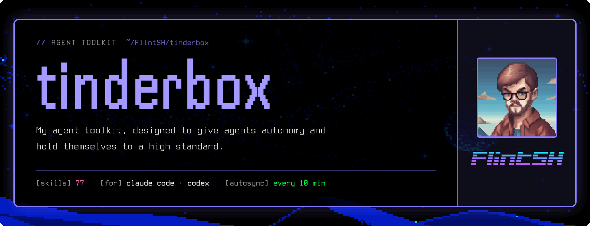
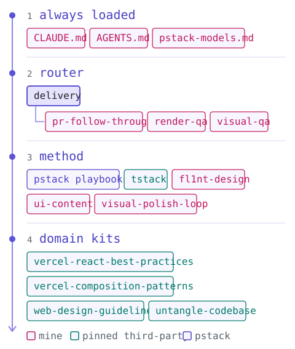

<!-- Generated by readme/render.mjs from readme/README.template.md and readme/copy.md. Edit those, not this file. -->

[](https://fl1nt.dev)

most agent setups make agents faster. tinderbox is setup for them to finish. every skill here is to get an agent to work at a high level of depth and quality.

i've found that slop can be largely preventable given the right agent setup - although i do believe human review is still important.

tinderbox is a collection of what works for me. some of it comes from other agent setups, some of it is tailored to how i work, some is left as is, and some is fully custom. it's the setup that works best for me, so take what's useful and change the rest.

## // opinionated defaults

tinderbox ships with a couple of different opinionated defaults. mainly aimed around giving agents the tools to validate, test, and review their changes before handing off to you.

| default | enforced by |
| --- | --- |
| **deliver the whole ask** | [delivery](plugins/tinderbox/skills/delivery/SKILL.md) |
| **all frontend changes must be validated with demos prepared** | [visual-qa](plugins/tinderbox/skills/visual-qa/SKILL.md) |
| **agents must use isolated worktrees and not step on eachother** | [delivery](plugins/tinderbox/skills/delivery/SKILL.md) |
| **always preserve product identity** | [router/core.md](router/core.md) |
| **follow any PR to completion, monitor CI and address reviews** | [pr-follow-through](plugins/tinderbox/skills/pr-follow-through/SKILL.md) |
| **only perform git actions when requested** | [delivery](plugins/tinderbox/skills/delivery/SKILL.md) |
| **always back everything in the repo being worked on and official docs** | [Context7](https://github.com/upstash/context7) |

## // how a task flows

every task goes through the same four layers. the rules load first, the router figures out what kind of work it is, and the right skills take it from there.

<picture>
  <source media="(prefers-color-scheme: dark)" srcset="assets/readme/flow-dark.svg">
  <source media="(prefers-color-scheme: light)" srcset="assets/readme/flow-light.svg">
  
</picture>

- **always loaded:** the global rules every session starts with, for both claude code and codex.
- **router:** delivery owns the task end to end and hands ui, pr and media work to the skill built for it.
- **method:** how the work actually gets done, with a strong set of standards.
- **domain kits:** narrow skills that load when an agent touches their area.

## // what's inside

| | skills |
| --- | --: |
| **mine** · [skills/](skills) | 3 |
| **tinderbox plugin** · [plugins/tinderbox/](plugins/tinderbox) | 4 |
| **Vercel** · [vercel-labs/agent-skills](https://github.com/vercel-labs/agent-skills) @ `063bee9` | 3 |
| **untangle-codebase** · [caldoai/skills](https://github.com/caldoai/skills) @ `f3cf477` | 1 |
| **tstack** · [t3dotgg/tstack](https://github.com/t3dotgg/tstack) @ `1085050`, 4 modified | 9 |
| **pstack** · [cursor/plugins](https://github.com/cursor/plugins/tree/main/pstack) @ `6b03002` | 58 |
| **total** | **78** |

<details>
<summary><b>every skill, with descriptions</b> (78)</summary>

**mine**

| skill | what it does |
| --- | --- |
| [fl1nt-design](skills/fl1nt-design/SKILL.md) | Apply the fl1nt.dev personal brand to interfaces, websites, desktop themes, graphics, documents, and other artifacts using verified website and rice evidence. Use when the user asks for fl1nt.dev branding, the fl1nt design language, or consistency with Flint's rice; do not apply merely because a project belongs to Flint. |
| [ui-content](skills/ui-content/SKILL.md) | Decide what goes on a screen, in what order, and in which words. Use automatically whenever you create UI (landing pages, docs sites, app screens, forms, dialogs, navigation) and whenever you are asked to clean up, tighten or rewrite the content of existing UI. Run it before building and again on the rendered result. It catches metadata and preamble ahead of the thing the page is for, labels and helper text that restate the obvious, slogan headings, pages where nothing leads, repeated content, and mock-ups standing in for the real product. Not for visual design. |
| [visual-polish-loop](skills/visual-polish-loop/SKILL.md) | Run a recursive, evidence-driven visual polish loop on a web UI. Audit every page, theme and state against a quality bar (palette, contrast, surfaces, typography, spacing, component states, focus), prototype genuinely different directions on the real pages, implement the winner through design tokens, then capture, have independent reviewers scrutinize, fix and repeat until a round comes back clean, and deliver a PR with before/after evidence and metrics. Use this whenever someone asks to polish, refine, clean up, unify, uplift or "make seamless" a UI, theme, palette or colour system, close a quality gap between two themes or screens, do a design or finish pass with high scrutiny, or says "visual clean loop" / "visual polish loop", even if they only mention colours or say it "doesn't feel as polished as" something. Not for building new features or single-bug visual fixes. |

**mine, modified from upstream**

| skill | what it does |
| --- | --- |
| [council](skills/council/SKILL.md) · from tstack | Trigger this if the user says 'council'. |
| [file-pr](skills/file-pr/SKILL.md) · from tstack | File a concise pull request. Use when the user asks to file, open, or create a PR. |
| [leaving-pr-comments](skills/leaving-pr-comments/SKILL.md) · from tstack | Use whenever leaving comments on GitHub. |
| [sol-loop](skills/sol-loop/SKILL.md) · from tstack | Use when the user says "sol loop". |

**tinderbox plugin**

| skill | what it does |
| --- | --- |
| [delivery](plugins/tinderbox/skills/delivery/SKILL.md) | Carry a software task end to end, from an isolated worktree through implementation, verification and delivery to a resumable handoff. Use for substantial feature, bug-fix or refactor work, especially when the user hands off a task and expects a finished, verified result without supervising it. |
| [pr-follow-through](plugins/tinderbox/skills/pr-follow-through/SKILL.md) | Finish a requested GitHub PR or review-fix task through tests, visual evidence, CI, inline/out-of-diff review comments, and AI review bot follow-up. Use for PR creation, failing checks, reviewer feedback, or requests to reach a review bot score. |
| [render-qa](plugins/tinderbox/skills/render-qa/SKILL.md) | Produce and verify code-rendered films, animation, browser scenes, and audio/video deliverables. Use for Remotion, Three.js, canvas, or FFmpeg media tasks that require finished artifacts, visual quality checks, and resumable multi-agent production. |
| [visual-qa](plugins/tinderbox/skills/visual-qa/SKILL.md) | Validate changed UI with headless Playwright, screenshots, short demos, console/network checks, and regression coverage. Use automatically for web UI, Electron renderer, browser game, or responsive-layout changes before reporting completion or opening a PR. |

**Vercel (MIT)**

| skill | what it does |
| --- | --- |
| `vercel-react-best-practices` | React and Next.js performance optimization guidelines from Vercel Engineering. This skill should be used when writing, reviewing, or refactoring React/Next.js code to ensure optimal performance patterns. Triggers on tasks involving React components, Next.js pages, data fetching, bundle optimization, or performance improvements. |
| `vercel-composition-patterns` | React composition patterns that scale. Use when refactoring components with boolean prop proliferation, building flexible component libraries, or designing reusable APIs. Triggers on tasks involving compound components, render props, context providers, or component architecture. Includes React 19 API changes. |
| `web-design-guidelines` | Review UI code for Web Interface Guidelines compliance. Use when asked to "review my UI", "check accessibility", "audit design", "review UX", or "check my site against best practices". |

**untangle-codebase (upstream license)**

| skill | what it does |
| --- | --- |
| `untangle-codebase` | Untangle a whole codebase in one pass, so agents working in it read less per change, break less without noticing, and debug faster. |

**tstack (MIT)**

| skill | what it does |
| --- | --- |
| `full-send` | Trigger this if the user says 'full send'. |
| `full-stop` | Trigger this if the user says 'full stop', even as a closing "Full stop." that reads like emphasis. |
| [council](skills/council/SKILL.md) · modified | Trigger this if the user says 'council'. |
| [sol-loop](skills/sol-loop/SKILL.md) · modified | Use when the user says "sol loop". |
| [file-pr](skills/file-pr/SKILL.md) · modified | File a concise pull request. Use when the user asks to file, open, or create a PR. |
| `takeover` | Take over existing work. Use when the user asks to take over a PR, branch, or agent thread, or requests a takeover. |
| `babysit-pr` | Monitor a pull request through review and CI. Use when the user asks to monitor, watch, or babysit a PR. |
| `modernize` | For getting old prs up to date. Use when asked to rebase a pr or "modernize". |
| [leaving-pr-comments](skills/leaving-pr-comments/SKILL.md) · modified | Use whenever leaving comments on GitHub. |

**pstack 0.15.36** (MIT)

`architect` `arena` `automate-me` `benchmark-checklist` `blast-radius` `bro` `correct` `create-formal-verification-skill` `create-verification-skill` `figure-it-out` `how` `in-your-own-words` `interrogate` `ketchup-video` `ketchup` `maintain-formal-verification-skill` `maintain-verification-skill` `make-bot-ui` `no-comments` `poteto-help` `poteto-mode` `principle-attack-the-premise` `principle-boundary-discipline` `principle-build-the-lever` `principle-encode-lessons-in-structure` `principle-exhaust-the-design-space` `principle-experience-first` `principle-explain-the-number` `principle-fix-root-causes` `principle-foundational-thinking` `principle-guard-the-context-window` `principle-laziness-protocol` `principle-make-operations-idempotent` `principle-migrate-callers-then-delete-legacy-apis` `principle-minimize-reader-load` `principle-model-the-domain` `principle-never-block-on-the-human` `principle-outcome-oriented-execution` `principle-prove-it-works` `principle-redesign-from-first-principles` `principle-separate-before-serializing-shared-state` `principle-sequence-verifiable-units` `principle-subtract-before-you-add` `principle-test-behavior-not-implementation` `principle-type-system-discipline` `recall` `reflect` `setup-pstack` `sharpen` `show-me-your-work` `statechart` `swarm` `tdd` `teach` `technical-writing` `typescript-best-practices` `unslop` `why`

Remotion skills and Playwright CLI skill are not installed by the script; it prints their install commands.

</details>

## // autosync

this repo should automatically update when my agent setup changes.

1. **watch:** skill folders in `~/.agents`, `~/.claude` and `~/.codex`, the global rules and the tinderbox plugin
2. **wait:** skip the run until nothing has changed for 2 minutes
3. **sync:** copy any folder with a `SKILL.md`, minus `sync.ignore` and third-party skills you haven't changed
4. **gate:** `scripts/check.sh` checks frontmatter, JSON, tokens and keys, and AI attribution; a failure blocks the push
5. **ship:** commit and push to `main` every 10 minutes, re-rendering this README when skills change

Setup and controls: [docs/AUTOSYNC.md](docs/AUTOSYNC.md).

## // install

this is built around my opinions, so please feel free to change anything that is different from how i work. contributions welcome!

One skill:

```sh
git clone https://github.com/FlintSH/tinderbox.git && cd tinderbox
cp -R skills/visual-polish-loop ~/.agents/skills/
ln -s ~/.agents/skills/visual-polish-loop ~/.claude/skills/visual-polish-loop
```

Everything:

```sh
# see what it would do
scripts/install.sh --all --dry-run
# skills, pinned upstream, tinderbox plugin, pstack (Claude Code + Codex)
scripts/install.sh --all
# optional: tinderbox defaults as a block in ~/.claude/CLAUDE.md and
# ~/.codex/AGENTS.md (your own rules there are kept)
scripts/install.sh --router
# optional: the same setup for Antigravity (agy) in ~/.gemini/config
scripts/install.sh --antigravity
```

skills install to `~/.agents/skills` (codex) and symlinks them to `~/.claude/skills` (claude code). Anything the installer replaces will move to `~/.local/share/tinderbox/backup/<timestamp>/`. routing details are in [docs/ROUTING.md](docs/ROUTING.md).

to give an idea on how to build on top of tinderbox, i also publish my personal adjustments as an example, which you can see as a reference under [router/personal/flint.md](router/personal/flint.md).

## // license

[MPL-2.0](LICENSE). My avatar, wordmark, backgrounds and site snapshots in
`skills/fl1nt-design` are not covered and stay all rights reserved; the fonts
keep their own licenses. Details in [NOTICE](NOTICE).

## // credits

Pinned, not vendored: [tstack](https://github.com/t3dotgg/tstack) by Theo Browne
(MIT), [pstack](https://github.com/cursor/plugins/tree/main/pstack) by Lauren Tan
(MIT), [Vercel agent skills](https://github.com/vercel-labs/agent-skills),
[untangle-codebase](https://github.com/caldoai/skills), Remotion's skills and
Playwright CLI. Fonts: Terminus (TTF), Space Mono and Handjet, SIL OFL 1.1.

<sub>This README is generated. Copy lives in [`readme/copy.md`](readme/copy.md); run `npm install && npm run render` in `readme/`.</sub>
